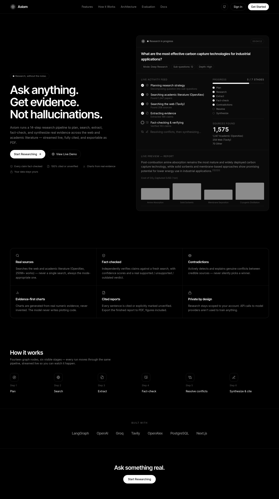
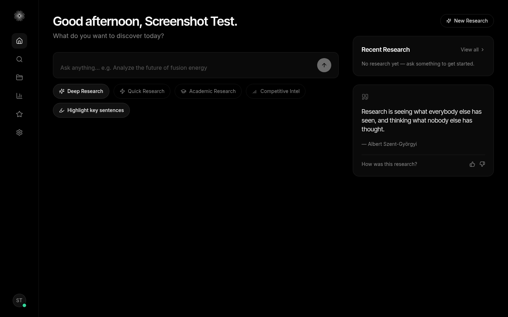
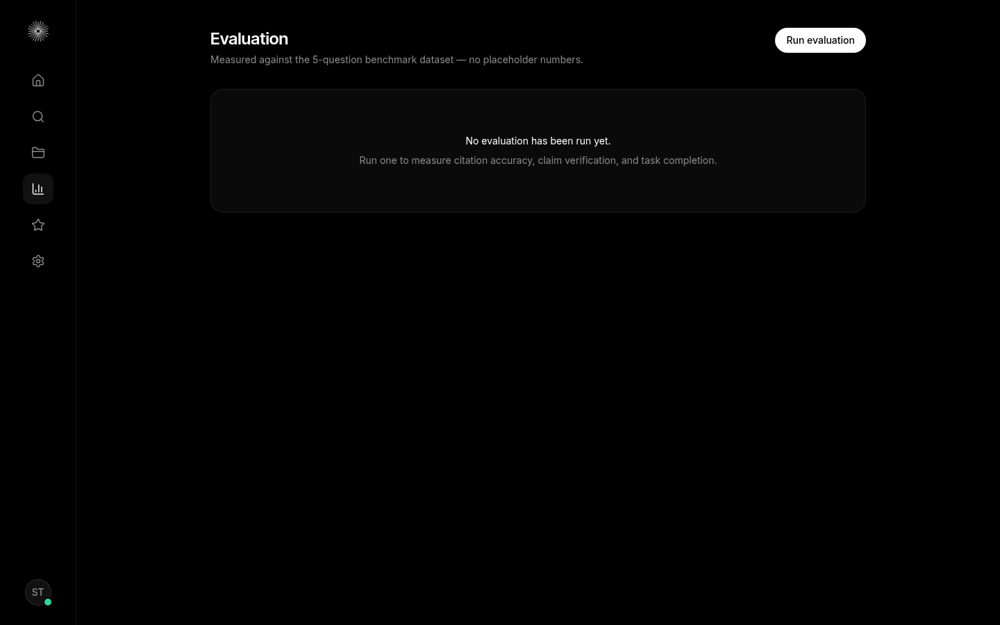
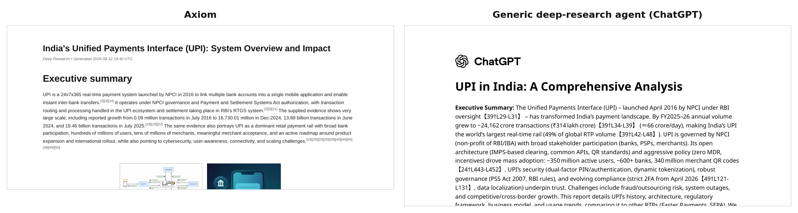
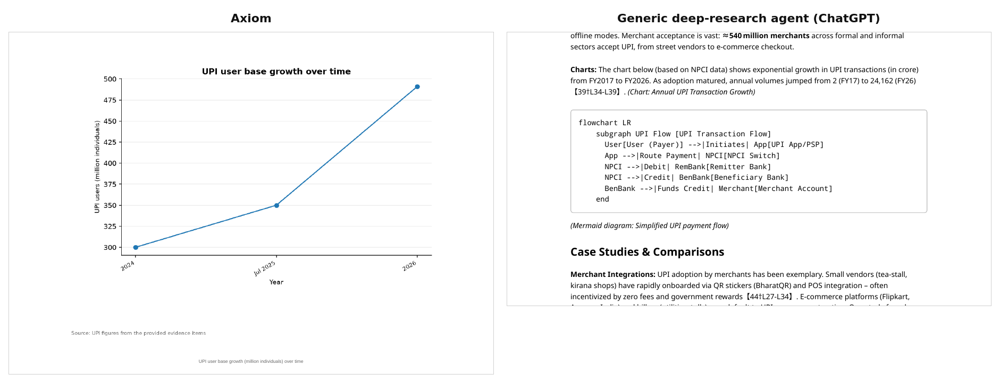
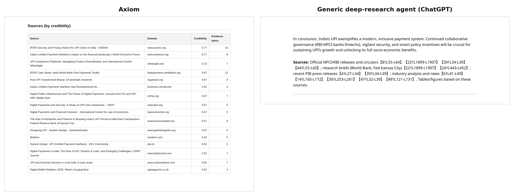

# Axiom

*Research, without the noise.*



Axiom is an autonomous research agent. You give it a question; it plans
sub-questions, searches the web and academic literature, extracts and
fact-checks evidence, hunts for contradictions between sources, draws charts
only from real numeric evidence, and writes a report in which every sentence
is either cited or explicitly marked `(unverified)`. The whole run streams
live over a WebSocket and exports to PDF. Spec: `PRD.md`. Project rules:
`CLAUDE.md`.

---

## Screenshots

| Home | Evaluation |
|---|---|
|  |  |

| Research history | Login |
|---|---|
|  |  |

More in [docs/screenshots/](docs/screenshots/).

---

## What it does

- **Four research modes**: Quick, Deep, Academic and Competitive Intel. Each
  sets a different sub-question count and depth.
- **Academic mode searches real scholarly literature.** It routes through
  OpenAlex (250M+ works) and pulls papers with abstracts, DOIs and citation
  counts. Academic provenance earns a source a credibility bonus.
- **Every claim is fact-checked and cited.** Evidence is extracted with
  excerpts and confidence scores, then verified against a fresh search. Every
  sentence in the report carries a `[n]` citation back to real evidence or is
  tagged `(unverified)`.
- **Contradictions are hunted, not missed.** A three-tier funnel (free numeric
  check → batched classification → reasoning-tier resolution) finds and
  explains real conflicts between sources instead of silently picking one.
- **Charts come from evidence, never from the model's imagination.** The model
  never writes plotting code. It proposes a chart, a separate step emits a
  structured spec, and every plotted value is checked against extracted
  evidence before matplotlib renders it.
- **Diagrams and images are real, not generated.** Architecture and process
  diagrams are written as Mermaid, validated (allowed diagram types only, no
  links or scripts) and rendered to SVG on the server. Reference diagrams come
  from Wikimedia Commons and matching photos from web image search, and every
  downloaded image passes SSRF, content-type and size checks. No
  image-generation model is called.
- **Key-passage highlighting.** Each report highlights its most important
  passages, capped at 9 in code so a highlight still means something.
- **Live agent activity feed.** You watch the real graph nodes run (what's
  searching, which sources were just found, which step just finished) on a
  7-stage progress timeline.
- **PDF export** with figures embedded, rendered fully offline.
- **Evaluation dashboard** that runs the pipeline against a benchmark set and
  reports real citation-accuracy and task-completion metrics. It shows the
  projected cost and asks for confirmation before spending anything.
- **Cost is enforced, not just tracked.** Every node checks a per-run cost
  ceiling before it executes, and the run aborts cleanly if the ceiling would
  be crossed.
- **Optional Groq reasoning tier** (`gpt-oss-120b`) at roughly 1/20th the
  per-token cost, with automatic fallback to OpenAI.

---

## Axiom vs. a generic deep-research agent

The same topic, **India's Unified Payments Interface (UPI)**, was given to
Axiom (Deep Research mode) and to ChatGPT's deep-research agent. Both
reports are in [docs/comparison/](docs/comparison/):

- [axiom-upi-report.pdf](docs/comparison/axiom-upi-report.pdf): Axiom
- [chatgpt-upi-report.pdf](docs/comparison/chatgpt-upi-report.pdf): ChatGPT deep research

### At a glance

| | **Axiom** | **Generic deep agent (ChatGPT)** |
|---|---|---|
| Citations a reader can follow | **188** inline `[n]` markers, each resolving to a numbered source with a real URL | 109 markers like `【39†L29-L31】`: internal browsing-session IDs and line ranges that don't resolve to anything in the PDF |
| URLs in the report | **17 unique URLs** across 16 domains | **0** |
| Source list | Numbered reference list **plus a credibility table** scoring 24 sources (0.52 – 0.77), with evidence counts per source | One paragraph: "Official NPCI/RBI releases… research briefs… industry analysis and news", followed by the same session IDs |
| Charts | A real line chart (UPI users 300M → 350M → 491M), plotted from cited evidence `[24][39][40]` | Text promises "the chart below… *(Chart: Annual UPI Transaction Growth)*", but no chart follows. A Mermaid code block appears in its place. |
| Diagrams | Rendered to SVG on the server from validated Mermaid: architecture flow, security/fraud-prevention flow, roadmap timeline | Two Mermaid diagrams left as **raw code**. One has a broken edge (`RemBank -->\|Debits user acct\|` points at nothing) and a garbled node (`Bonclude[Picks up funds]`). |
| Claims without support | Tagged `(unverified)` in the text | Unmarked. Examples with no citation: "≈540 million merchants", "~40% of urban women and ~50% of rural women use UPI", "high-profile outages (March/April 2025)", "UPI 2.0 (Oct 2018)" |
| Conflicting sources | Called out: "the supplied sources differ on the current totals", then all three figures (300M / 350M / 491M users) are given with their sources | Never flags disagreement between sources. "≈540 million merchants" sits next to "340 million merchant QR codes" with no reconciliation. |
| Images | Two AI illustrations, each labelled *"AI-generated illustration, not derived from evidence"*. This run predates the switch to real images: current Axiom runs use Wikimedia Commons diagrams and real web photos instead. | None |
| Key-sentence highlighting | The main finding of each section is highlighted | None |

### See the difference

**1. Citations a reader can check vs. citations only the agent can read**



Axiom's `[3][4][14]` points to entry 3, 4 and 14 in the reference list, each
with a URL (World Bank, PIB, WEF…). ChatGPT's `【39†L29-L31】` refers to
"line 29–31 of the 39th page the agent opened during its session". That
mapping isn't shipped with the report, so the reader can't open the source.

**2. A chart from evidence vs. a promised chart that never appears**



Axiom's `figure_planner` is instructed to propose a chart only when at least
three evidence items share a comparable numeric unit, and code rejects any
chart that cites fewer than two. `chart_generator` then checks every plotted
value against that evidence before rendering. The same rule covers diagrams:
Axiom renders its Mermaid on the server and drops any diagram that fails
validation, so a reader never sees raw diagram code. The generic agent says
"the chart below shows exponential growth" and then outputs an unrendered
Mermaid flowchart of something else.

**3. A scored source list vs. a summary sentence**



Axiom appends a source table built programmatically from the database, not
written by the LLM. Each source has a credibility score (domain, source
type, date and cross-source corroboration) and the number of evidence items
taken from it. The generic agent ends with a sentence describing the *kinds*
of sources it used.

### Where the generic agent's report is stronger

To keep the comparison fair:

- **Breadth.** ChatGPT's report covers fee economics (zero MDR, NPCI
  switching fees, incentive schemes), a stakeholder table, comparisons with
  Faster Payments and SEPA, and policy recommendations. Axiom's report sticks
  closer to what its evidence pool supports.
- **Recency.** It brings in more 2026 detail: the March 2026 monthly peak,
  June 2026 volumes, and the April 2026 2FA mandate. Axiom's most recent
  figure is the FY2025–26 annual value from PIB.
- **Readability.** Axiom's evidence-first style ("the supplied evidence
  says…") is more hedged, and its reference list repeats a source once per
  evidence item (52 entries, 17 unique URLs).

The trade-off is deliberate. Axiom is built so that **what it says can be
traced and checked**, even if that makes it say less.

---

## Architecture

```
┌─────────────────┐        ┌──────────────────────────────────────────┐
│  Next.js 16      │  REST  │  FastAPI                                  │
│  (React 19)      │◄──────►│   ├─ auth (JWT access + refresh)          │
│  :3000           │   WS   │   ├─ research CRUD + history              │
│                  │◄──────►│   ├─ reports, sources, evidence, trace    │
└─────────────────┘        │   ├─ figures, eval                        │
                            │   └─ WebSocket live-run stream            │
                            │        :8000                              │
                            └───────────────┬────────────────────────────┘
                                             │ BackgroundTasks (in-process,
                                             │ no Celery worker yet)
                                             ▼
                            ┌──────────────────────────────────────────┐
                            │  LangGraph pipeline (16 nodes, sequential) │
                            │  planner → web_researcher → ... →          │
                            │  citation_validator                        │
                            │  every node wrapped in @traced             │
                            └───────────────┬────────────────────────────┘
                                             │
              ┌────────────────┬─────────────┼──────────────┬────────────────┐
              ▼                ▼             ▼              ▼                ▼
     ┌────────────────┐ ┌───────────┐ ┌────────────┐ ┌────────────┐ ┌───────────────┐
     │ PostgreSQL 16   │ │ OpenAI     │ │ Groq        │ │ Tavily      │ │ OpenAlex       │
     │ + pgvector      │ │ (fast tier,│ │ (optional,  │ │ (web search)│ │ (academic mode │
     │                 │ │ embeddings,│ │ reasoning   │ │             │ │  search, free) │
     │                 │ │ images)    │ │ tier)       │ │             │ │                │
     └────────────────┘ └───────────┘ └────────────┘ └────────────┘ └───────────────┘
```

- **Backend**: FastAPI + LangGraph 1.x, SQLAlchemy (async) over Postgres/pgvector, Redis present but unused (no Celery worker yet — runs execute as an in-process `BackgroundTask`).
- **Frontend**: Next.js 16 (App Router) + React 19 + Tailwind v4, TanStack Query for data fetching, a hand-rolled `useResearchSocket` hook for the live WebSocket stream.
- **LLM access**: a single `LLMProvider` behind a task→route table (`app/llm/router.py`) that resolves each named task to a model tier (`reasoning` / `fast`), a provider (OpenAI or, optionally, Groq — see below), a reasoning-effort level, and a `max_completion_tokens` cap — nodes never hardcode a model name.
- Every graph node is decorated with `@traced`, which opens/commits the node's DB writes, records a `node_traces` row (tokens, latency, cost, input/output snapshot), and enforces `MAX_RUN_COST_USD` before the node runs.

## Running it

```bash
docker compose up
```

Brings up Postgres (pgvector), Redis, the backend (`:8000`), and the frontend
(`:3000`). The backend runs `alembic upgrade head` on every start. Real API
keys (OpenAI, Tavily) live in `.env` at the repo root (gitignored); `.env.example`
documents every variable.

### Known dev-environment quirks

- **Backend hot-reload kills in-flight runs.** `uvicorn --reload` restarts the
  process on any file save; a run mid-execution has its state discarded
  (already-written `raw_findings`/`evidence` rows survive, but the run's
  `status` is stuck at `"running"` forever). Not a bug in the graph — avoid
  editing backend files while a run you care about is executing.
- **Frontend dev server (`next dev`) currently 404s on any route two or more
  path segments deep** — e.g. `/research/{id}/report`, `/sources`,
  `/evidence`, `/trace` — regardless of whether the segment is static or
  dynamic. Reproduced against a brand-new throwaway route in both Turbopack
  and webpack dev modes, surviving a full container recreate, so it's a
  Next.js 16.3.0 dev-server route-discovery issue, not application code.
  `next build && next start` resolves every route correctly. If a nested
  route 404s during development, that's this issue, not a regression.

## The graph pipeline

Defined in `backend/app/graph/graph_builder.py`. Sixteen nodes, executed
sequentially per run (no `Send()`-based fan-out anywhere in this codebase —
even "parallel" work like fact-checking multiple claims or generating
multiple charts is a `for` loop inside one node). Every node lives in
`backend/app/graph/nodes/`.

| # | Node | What it does |
|---|------|---------------|
| 1 | `planner` | Reasoning-tier call that turns the query into a `ResearchPlan` — an objective plus 3–12 sub-questions (count depends on mode: quick/deep/academic/competitive). |
| 2 | `web_researcher` | For each sub-question, searches and fetches page text, persisting a `Source` row per unique URL. **Branches on mode**: academic mode searches OpenAlex's `/works` endpoint instead of Tavily, reconstructing each paper's abstract from OpenAlex's word-position inverted index (never returned as plain text) and using it directly as evidence — no separate fetch step, unlike a web result. Bounded by `MAX_TOOL_CALLS_PER_NODE`; a failed fetch is logged to `errors` and the loop continues. |
| 3 | `evidence_extractor` | Batches the raw fetched content (3 sources at a time) through a fast-tier structured-output call that pulls out discrete claims — each with a supporting excerpt, confidence, and optional `numeric_value`/`numeric_unit`/`time_period` — and persists them as `Evidence` rows. |
| 4 | `credibility_scorer` | Embeds all evidence (`ensure_evidence_embeddings`, idempotent — this is the first node that needs embeddings, so it pays for them), counts how many *other* sources corroborate each source's claims via cosine similarity, and scores every `Source` from domain/type/date/corroboration signals — academic sources get a real credibility bonus. |
| 5 | `retriever` | Hybrid retrieval (vector + BM25/full-text, reciprocal-rank fusion) per sub-question over this run's whole evidence pool, then reranks with a fast-tier LLM call down to the top-K, deduplicated, into `retrieved_evidence` — the set every downstream node (and the synthesizer's citation markers) actually uses. |
| 6 | `fact_checker` | Clusters `retrieved_evidence` by embedding similarity, prioritizes clusters (numeric > low-credibility > topically-central), and independently verifies only the top `MAX_FACT_CHECKS_{QUICK,DEEP}` representatives via a fresh search + fast-tier verdict (`supported`/`unsupported`/`outdated`), propagating the verdict to every cluster member. Unreached clusters get an explicit `unverified` — never a silent gap. |
| 7 | `contradiction_detector` | Three-tier funnel: (1) free numeric-threshold check within same-unit clusters, (2) one fast-tier batched classification call per group to flag candidate pairs, (3) one reasoning-tier call per flagged pair to confirm/reject and explain. Confirmed pairs become `Contradiction` rows. |
| 8 | `figure_planner` | Reasoning-tier call that looks at `retrieved_evidence` and proposes 0+ figure requests (`FigureRequest`, `kind` = `"chart"` or `"diagram"`). A chart is only proposed when ≥3 evidence items genuinely share a comparable numeric unit (code rejects any chart citing fewer than 2) — a missing chart is correct behavior when the data doesn't support one. A diagram depicts a named structure or process and needs ≥1 evidence id. Every cited `evidence_id` is checked against the real evidence set before being trusted forward; capped by `MAX_FIGURES_PER_REPORT`. |
| 9 | `chart_generator` | One fast-tier call per accepted `kind="chart"` request, emitting a validated `ChartSpec` (chart type, series, categories, labels). Every plotted value is checked against the referenced evidence's real `numeric_value`s before acceptance — the model **never emits plotting code**; matplotlib renders the accepted spec to PNG, stored content-addressed under `FIGURES_DIR`, and persisted as a `Figure` row. |
| 10 | `diagram_generator` | One fast-tier call per `kind="diagram"` request, emitting a `DiagramSpec` (Mermaid source). The spec is validated — allowed diagram types only, declared type must match the source, no `click`/`href`/script — then rendered to SVG by mermaid-cli (`mmdc`) in a subprocess with a hard timeout. A rejected or failed render drops the figure, never the run. |
| 11 | `illustration_planner` | Reasoning-tier call proposing 0–2 reference-image requests — deliberately a separate type (`IllustrationRequest`) from `FigureRequest`, capped by `MAX_ILLUSTRATIONS_PER_REPORT`. Evidence ids are checked against the real set and used for attribution. |
| 12 | `image_generator` | Despite the name, generates nothing: one small call writes a search query, then a real, existing diagram is found on Wikimedia Commons, downloaded through the SSRF-safe fetch/validate pipeline, and stored as `kind="reference_diagram"`. No image-generation model is called. (Older reports may still contain legacy `kind="illustration"` AI images, which keep their "AI-generated" disclaimer.) |
| 13 | `web_image_fetcher` | Pairs each reference diagram with a real photo: tries up to `WEB_IMAGE_SEARCH_CANDIDATES` Tavily image results in ranked order and keeps the first that passes SSRF, content-type and dimension validation (`kind="source_image"`). Non-fatal — a diagram can stand alone. |
| 14 | `synthesizer` | Reasoning-tier call, **streamed** token-by-token over the WebSocket (`report_chunk` frames). Writes the report body with `[n]` citation markers and places every figure it was given (charts near the data they illustrate, images near the top) — a figure that reaches this node was already generated at real cost, so declining to use it wastes money for nothing. The Sources and Contradictions-Noted sections are never LLM-authored — built programmatically from the real `Source`/`Contradiction` rows and appended after. |
| 15 | `citation_validator` | Pure Python, no LLM call. Regex-based sentence splitting checks every `[n]` marker resolves to a real evidence index, and flags claim-bearing sentences with neither a marker nor an `(unverified)` tag. Passing persists the `Report` row; failing routes back to `synthesizer` with the exact flagged sentences quoted verbatim (up to `MAX_CITATION_RETRIES` times) so the retry is a targeted fix, not a blind re-roll. |
| 16 | `force_finalize` | Only reached if citation validation still fails after all retries — auto-tags every remaining flagged sentence `(unverified)` and persists, so a run always terminates with a citable report rather than looping forever. |

**Conditional edge**: `citation_validator` → `route_after_validation` → one of `done` (END) / `retry` (back to `synthesizer`) / `finalize` (`force_finalize` → END).

**Figure kinds**: `chart` (`chart_generator`), `diagram` (`diagram_generator`), `reference_diagram` (`image_generator`), `source_image` (`web_image_fetcher`). The legacy `illustration` kind is still rendered for older reports but is no longer produced.

## REST API

All routes under `/api/v1` except `/health`. Auth via `Authorization: Bearer <access_token>` (15 min lifetime) unless noted; `/auth/refresh` rotates both tokens.

| Method | Path | Purpose |
|---|---|---|
| GET | `/health` | Liveness check, no auth. |
| POST | `/auth/register` | Create a user, returns token pair. |
| POST | `/auth/login` | Returns token pair. |
| POST | `/auth/refresh` | Exchanges a refresh token for a new access token (rotates the refresh token too). |
| GET | `/auth/me` | Current user. |
| POST | `/auth/logout` | Revokes a refresh token. |
| POST | `/research` | Starts a run (`{query, mode}`, mode ∈ `quick`/`deep`/`academic`/`competitive`). Fires the graph as a `BackgroundTask`; returns immediately with `run_id`. |
| GET | `/research` | Paginated run history for the current user (`limit`, `offset`). |
| GET | `/research/{run_id}` | Run status/metadata (tokens, cost, latency). |
| GET | `/research/{run_id}/report` | Final report markdown + citations. |
| POST | `/research/{run_id}/report/pdf` | Renders and stores a PDF export, returns a download URL. |
| GET | `/research/{run_id}/report/pdf/file` | Downloads the exported PDF file. |
| GET | `/research/{run_id}/sources` | All sources found, with credibility scores. |
| GET | `/research/{run_id}/evidence` | All evidence, joined with source + fact-check status. |
| GET | `/research/{run_id}/contradictions` | Confirmed contradictions for the run. |
| GET | `/research/{run_id}/figures` | Figures generated for the run (metadata only). |
| GET | `/figures/{figure_id}/file` | Downloads a figure's PNG bytes (auth-checked, not a static file mount). |
| GET | `/research/{run_id}/trace` | Per-node trace: status, latency, cost, input/output snapshots. |
| GET | `/eval/config` | Real dataset size + enforced cost ceiling — backs the "Run evaluation" confirmation dialog. |
| GET | `/eval` | Recent eval runs (shared benchmark, not per-user). |
| GET | `/eval/{eval_id}` | Metrics for one eval run. |
| POST | `/eval/run` | Kicks off a real, billed evaluation pass over the benchmark dataset (fire-and-forget background task); can resume a prior run or reuse `existing_run_ids` instead of re-running a question. |
| WS | `/ws/research/{run_id}?token=` | Live run stream — see below. |

## WebSocket protocol

`ws(s)://.../api/v1/ws/research/{run_id}?token={access_token}`. On connect,
the server sends a `snapshot` frame (full current state — makes a page
refresh mid-run resync correctly), then streams live frames until a terminal
one. Close codes `4401` (bad/expired token) and `4403` (run belongs to
another user) are sent only after `accept()`, so the browser's `onclose` can
actually see them.

Frame types (`app/observability/events.py`): `snapshot`, `node_started`, `node_finished`, `progress`, `stat`, `source_found`, `contradiction_found`, `report_chunk`, `done`, `error`.

The 16 graph nodes are bucketed into a fixed **7-stage** progress enum for the timeline UI (`STAGE_BY_NODE`): `understanding_query`, `creating_plan`, `searching_sources`, `extracting_evidence`, `fact_checking`, `resolving_conflicts`, `generating_report` — e.g. `credibility_scorer`+`retriever` both bucket under `extracting_evidence`, and all six figure/image nodes bucket under `generating_report`. The frontend's live activity feed (`components/run/ActivityFeed.tsx`) reads `node_started`/`node_finished` directly rather than through this bucketing, so it always shows the real node-level detail (e.g. "Cross-checking sources", "Comparing findings for conflicts") even for nodes that share a stage.

## Data model

Postgres, one row set per run (all FK'd to `research_runs.id`, cascade-deleted with it):

| Table | Holds |
|---|---|
| `users` / `refresh_tokens` | Auth. |
| `research_runs` | One row per query: mode, status, plan (JSONB), token/cost/latency totals. |
| `sources` | Every URL fetched, with domain, type, publication date, credibility score. |
| `evidence` | Every extracted claim: excerpt, confidence, optional numeric value/unit/time period, a 1536-dim pgvector embedding, full-text-search column. |
| `fact_check_results` | One per evidence item: `supported`/`unsupported`/`outdated`/`unverified`, verifying URL, notes. |
| `contradictions` | Confirmed contradictions between two evidence items, with explanation. |
| `figures` | Charts, diagrams and images: `kind` (`chart`/`diagram`/`reference_diagram`/`source_image`, plus legacy `illustration`), caption, file path, mime type, the full spec (JSONB, chart only), and the evidence ids it's attributed to (DB constraint: must be non-empty). |
| `reports` | Final markdown + structured citations (JSONB) + referenced figure ids. |
| `node_traces` | Per-node-execution trace: tokens, latency, cost, status, input/output snapshots — powers the Trace UI. |
| `eval_runs` | Benchmark evaluation runs (shared, not per-user): dataset version, metrics JSONB. |
| `user_preferences` | Preferred mode/source types/report format. |

## Frontend routes

| Route | Shows |
|---|---|
| `/login`, `/register` | Auth. |
| `/` | Home — greeting, research input + mode selector, a live run card for the most recent run (see below), recent-research list. |
| `/history` | Paginated run history. |
| `/research/{id}` | Live workspace — the same live run card, full-width, for viewing a run directly by URL (also correctly resyncs from the `snapshot` frame after a mid-run refresh). |
| `/research/{id}/report` | Final report: citations open a modal with the source excerpt, credibility, and fact-check status; `figure://` references render inline via an authenticated blob-fetch (`ReportFigure`) — charts and diagrams full-width, reference diagrams and photos sized like a small figure in a printed book (legacy AI illustrations keep their permanent "AI-generated" disclaimer); PDF export button. |
| `/research/{id}/sources` | Sources table with a monochrome credibility meter. |
| `/research/{id}/evidence` | Every claim with topic, source, and fact-check status; contradictions section. |
| `/research/{id}/trace` | Per-node latency/cost table. |
| `/evaluation` | Metrics table for the latest eval run, or an empty state; "Run evaluation" requires confirming a real, displayed cost cap before it fires. |
| `/search`, `/saved`, `/settings` | Stubs ("coming soon") — not built out this phase. |

**The live run card** (`components/home/LiveRunCard.tsx`) is what makes a run feel alive rather than a spinner: an `ActivityFeed` panel with an animated headline showing what's actually running right now (crossfades on change, small breathing indicator), a live-scrolling feed of real completed steps and source discoveries as they stream in, a rotating witty status line (structurally kept out of the real event log — decorative copy can never be mistaken for actual status), the 7-stage progress timeline, and a stat strip. On reconnect or a page refresh mid-run, the activity log backfills from the `snapshot` frame's `node_traces` so history isn't lost.

## Cost & safety limits (`app/config.py`)

Enforced per node by `@traced`, not just documented: `MAX_RUN_COST_USD` (1.50), `MAX_EVAL_COST_USD` (1.50), `MAX_TOOL_CALLS_PER_NODE` (8), `MAX_FACT_CHECKS_QUICK/DEEP` (10/40), `MAX_FIGURES_PER_REPORT` (6), `MAX_ILLUSTRATIONS_PER_REPORT` (2, bounds the search/fetch/download cost of reference images), `WEB_IMAGE_SEARCH_CANDIDATES` (3), `MAX_HIGHLIGHTS_PER_REPORT` (9), `MAX_CITATION_RETRIES` (2), `RUN_TIMEOUT_SECONDS` (900). Model tiers, providers, reasoning-effort levels, and per-task `max_completion_tokens` caps are all in `app/llm/router.py`'s `ROUTES` table, never hardcoded per node.

## Optional: Groq for the reasoning tier

Set `REASONING_PROVIDER=groq` (default `openai`) plus a real `GROQ_API_KEY` to route every reasoning-tier task through Groq-hosted `openai/gpt-oss-120b` — chosen specifically because it's one of the only Groq models supporting the full `low`/`medium`/`high`/`none` reasoning-effort range this codebase already uses. Verified against the real API at roughly **1/20th the per-token cost** of the OpenAI reasoning tier. Any Groq failure (a real risk on its free tier's tight per-minute token cap) is caught and silently retried once against the OpenAI reasoning-tier model for that call — a rate limit degrades one call's cost, it doesn't fail the run. Fast-tier tasks and embeddings are unaffected regardless of this setting; Groq has no embedding API.

## Production deployment

`docker-compose.prod.yml` + `frontend/Dockerfile.prod` — a real production build (`next build && next start`, not `next dev`) and `entrypoint.sh` drops uvicorn's `--reload` when `ENV=production`. No `redis` service (confirmed nothing in the backend ever connects to it). Meant to run as its own isolated stack — own network, own volumes — so it's safe to deploy alongside other unrelated services on the same host:

```bash
docker compose -f docker-compose.prod.yml --env-file .env.production up -d --build
```

`.env.production` follows the same shape as `.env.example` — generate fresh `JWT_SECRET`/`POSTGRES_PASSWORD` (`openssl rand -hex 32`) rather than reusing dev values, and set `CORS_ORIGINS`/`NEXT_PUBLIC_API_URL`/`NEXT_PUBLIC_WS_URL`/`PUBLIC_BASE_URL` to wherever it's actually reachable — `NEXT_PUBLIC_*` vars are inlined into the client bundle by `next build` itself, so they must be passed as Docker build `args`, not just container environment (see `docker-compose.prod.yml`'s `frontend.build.args`) — env-file-only would silently ship a `localhost` URL.

**A real cross-platform gotcha this surfaced**: if you're developing on Windows with `core.autocrlf=true`, `git archive` (or a fresh `git clone`) will silently convert every text file's line endings to CRLF on export — not just on checkout, which is the commonly-known half of this issue. That breaks a shell script's shebang instantly (`env: 'bash\r': No such file or directory`). `.gitattributes` (`* text=auto eol=lf`) fixes it unconditionally, already committed in this repo.

## Tech stack

| | |
|---|---|
| Backend | Python 3.12, FastAPI, LangGraph 1.2.10, SQLAlchemy 2.x (async), Alembic, pgvector, matplotlib, mermaid-cli (diagram rendering), Playwright (PDF rendering), bleach |
| Frontend | Next.js 16.3, React 19.2, Tailwind CSS v4, TanStack Query v5, react-markdown v9, lucide-react, motion |
| Infra | PostgreSQL 16 + pgvector, Redis (present, unused — no Celery worker yet), Docker Compose |
| External APIs | OpenAI (fast-tier tasks, embeddings, and the reasoning tier by default), Groq (optional, cheaper reasoning-tier alternative — `openai/gpt-oss-120b`), Tavily (web search and image search), OpenAlex (academic-mode search, free, no per-call cost), Wikimedia Commons (reference diagrams) |
